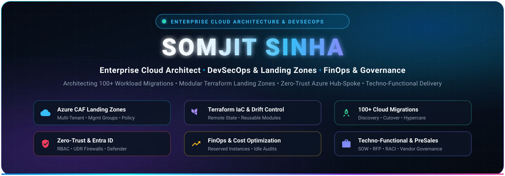
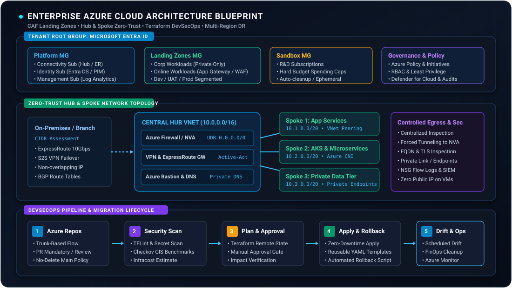

<div align="center">

<!-- Hero Banner -->


<br/>

<!-- Quick Connect & Status Badges -->
[](https://linkedin.com/in/somsinha123)
[](mailto:somsinha123@gmail.com)
[](https://github.com/somsinha123)
[](https://github.com/somsinha123)

<br/>

<!-- Dynamic Tagline -->
<h3>
  Enterprise Cloud Architect &nbsp;|&nbsp; DevSecOps &amp; Infrastructure as Code &nbsp;|&nbsp; FinOps &amp; Governance
</h3>

<p align="center">
  <b>Bridging Techno-Functional Strategy with Scalable, Zero-Trust Enterprise Multi-Cloud Implementations</b>
</p>

---

<!-- Key Highlights Metric Cards Table -->
<table align="center" width="100%">
  <tr>
    <td align="center" width="20%">
      <h3>100+</h3>
      <p><b>Workloads Migrated</b><br/><sub>Dev, UAT &amp; Prod Migration Factory</sub></p>
    </td>
    <td align="center" width="20%">
      <h3>CAF</h3>
      <p><b>Enterprise Landing Zones</b><br/><sub>Multi-Tenant Mgmt Groups &amp; Policies</sub></p>
    </td>
    <td align="center" width="20%">
      <h3>99.99%</h3>
      <p><b>High Availability Architecture</b><br/><sub>Multi-Region DR, VMSS &amp; RTO/RPO SLAs</sub></p>
    </td>
    <td align="center" width="20%">
      <h3>30%+</h3>
      <p><b>FinOps Cost Optimization</b><br/><sub>Reserved Capacity, Idle Audits &amp; Sizing</sub></p>
    </td>
    <td align="center" width="20%">
      <h3>Zero-Trust</h3>
      <p><b>Security &amp; Governance</b><br/><sub>Central Inspection, UDR &amp; Entra ID PIM</sub></p>
    </td>
  </tr>
</table>

</div>

---

## Executive Summary

I am a **Techno-Functional Enterprise Cloud Architect and DevSecOps Leader** with extensive hands-on experience designing, governing, and automating mission-critical cloud infrastructure at scale. My core domain lies in orchestrating end-to-end cloud transformations: from **Cloud Adoption Framework (CAF) Landing Zone design**, **Terraform modular automation**, and **100+ multi-tier application migrations**, to **Zero-Trust network perimeters**, **FinOps cloud financial governance**, and **Vendor Delivery management**.

Having operated across technical architecture, pre-sales, technical account management (TAM), and delivery leadership, I translate C-level business requirements into resilient, compliant, and cost-effective digital platforms.

---

## Enterprise Azure Architecture Blueprint

Below is an overview of the production-tested landing zone and networking architecture I design and implement across large enterprise estates:

<div align="center">
  
</div>

<details>
<summary><b>Click to expand Architectural Details &amp; Component Breakdown</b></summary>

<br/>

### 1. Tenant & Management Group Hierarchy
- **Microsoft Entra ID Root**: Centralized identity boundary with Conditional Access, Privileged Identity Management (PIM), and emergency glass-break accounts.
- **Platform Management Group**:
  - `Connectivity`: Dedicated subscription hosting ExpressRoute Gateways, VPNs, Azure Firewall, and Private DNS Resolvers.
  - `Identity`: Isolated subscription for Active Directory Domain Services, Key Vaults, and PAM tooling.
  - `Management`: Central Log Analytics Workspace, Azure Monitor, and enterprise automation engines.
- **Landing Zones Management Group**:
  - `Corp Workloads`: Non-public facing workloads routed strictly through internal hub firewalls.
  - `Online Workloads`: Public-facing applications fronted by Application Gateway / WAF and DDoS Protection.
  - Strict environment separation across `Dev`, `UAT`, and `Prod` with scoped RBAC and Azure Policy inheritance.
- **Sandboxes & Decommissioned MGs**: Ephemeral sandbox environments bounded by rigid spending quotas, plus controlled offboarding for deprecated resources.

### 2. Zero-Trust Hub-and-Spoke Networking Model
- **Centralized Inspection**: All egress and inter-spoke traffic is forced via User Defined Routes (UDR `0.0.0.0/0`) through Azure Firewall / NVA with deep packet inspection.
- **Private Link Architecture**: Zero public IPs allocated to virtual machines or databases; all PaaS resources accessed via Private Endpoints.
- **Hybrid Interconnect**: High-throughput ExpressRoute with automatic S2S VPN failover, strict on-premises CIDR assessment, and non-overlapping IP allocation.

### 3. Terraform IaC & DevSecOps Lifecycle
- **Modular Terraform Structure**: Independent state files per tier stored in Azure Storage with least-privilege RBAC, encryption-at-rest, and state locking.
- **Automated Quality Gates**: CI/CD pipelines enforcing `tflint`, secret scanning (`git-secrets`), static security scanning (`checkov`), and cost impact estimation (`infracost`).
- **Drift Detection**: Daily scheduled pipelines detecting configuration drift and alerting engineering squads immediately.

</details>

---

## Core Competency Matrix

<table>
  <thead>
    <tr>
      <th width="35%">Domain</th>
      <th width="65%">Core Capabilities &amp; Production Deliverables</th>
    </tr>
  </thead>
  <tbody>
    <tr>
      <td><b>Cloud Architecture &amp; Landing Zones</b></td>
      <td>
        • <b>Microsoft Cloud Adoption Framework (CAF)</b>: Strategy, Plan, Ready, Adopt, Govern, Secure, Manage.<br/>
        • <b>Management Group Design</b>: Tenant boundaries, Subscription vending machine, Initiative assignments.<br/>
        • <b>Subscription Lifecycle</b>: Onboarding, offboarding, policy exemption justifications with audit trails.
      </td>
    </tr>
    <tr>
      <td><b>Enterprise DevSecOps &amp; IaC</b></td>
      <td>
        • <b>Terraform at Scale</b>: Remote state architecture, reusable modular repositories, least-privilege state access.<br/>
        • <b>Pipeline CI/CD</b>: Azure DevOps &amp; GitHub Actions multi-stage YAML templates (Validate, Test, Build, Plan, Apply, Rollback).<br/>
        • <b>Branching Governance</b>: Trunk-based branching, mandatory PR policies, Code Owners, branch protection rules.<br/>
        • <b>Drift &amp; Security Automation</b>: Checkov, TFLint, automated rollback triggers, middleware automation via custom data scripts.
      </td>
    </tr>
    <tr>
      <td><b>100+ Workload Cloud Migration Factory</b></td>
      <td>
        • <b>End-to-End Migration Framework</b>: Discovery, Port &amp; CIDR Assessment, Application Dependency Mapping, Readiness Gates.<br/>
        • <b>Execution Checklists</b>: Pre-migration signoff, cutover runbooks, zero-loss database sync, post-migration validation.<br/>
        • <b>Cutover &amp; Hypercare</b>: Production cutover orchestration, disaster mitigation, 24/7 hypercare support model.
      </td>
    </tr>
    <tr>
      <td><b>Zero-Trust Security &amp; Compliance</b></td>
      <td>
        • <b>4-Tier Security Perimeter</b>: Identity Level, Networking Level, Governance Level, Compute Level.<br/>
        • <b>Enterprise Identity</b>: Entra ID, RBAC group delegation, Defender for Cloud, Azure Policy guardrails.<br/>
        • <b>Secret Management</b>: Azure Key Vault integration with managed identities, automated certificate renewals.
      </td>
    </tr>
    <tr>
      <td><b>FinOps &amp; Cloud Cost Governance</b></td>
      <td>
        • <b>Waste Reduction</b>: Automated detection and cleanup of idle resources, orphaned disks, and oversized instances.<br/>
        • <b>Cost Optimization</b>: Reserved Instances (RI) &amp; Savings Plans modeling, auto-shutdown/auto-start schedules.<br/>
        • <b>Telemetry &amp; Storage</b>: Log Analytics ingestion filtering, retention policy optimization, blob tiering (Hot/Cool/Archive).
      </td>
    </tr>
    <tr>
      <td><b>Disaster Recovery &amp; High Availability</b></td>
      <td>
        • <b>Resilience Engineering</b>: VM Scale Sets (VMSS), Availability Zones (ZRS), Multi-Region pairing (GRS).<br/>
        • <b>Business Continuity SLAs</b>: Rigid RTO (Recovery Time Objective) and RPO (Recovery Point Objective) adherence.<br/>
        • <b>Failover Testing</b>: Automated Azure Site Recovery (ASR) DR drills and active-passive failover validation.
      </td>
    </tr>
    <tr>
      <td><b>Techno-Functional &amp; Vendor Leadership</b></td>
      <td>
        • <b>Vendor Governance</b>: Task assignment, SOW formulation, deliverable acceptance criteria, SLA tracking.<br/>
        • <b>Presales &amp; Proposals</b>: RFP/RFI responses, commercial proposals, technical evaluation matrices, estimation models.<br/>
        • <b>Transition &amp; People</b>: RACI matrix design, knowledge transfer (KT) sessions, upskilling, senior hiring panels.
      </td>
    </tr>
  </tbody>
</table>

---

## 100+ Application Migration Framework (The Playbook)

```
+---------------------------------------------------------------------------------------------------------+
|                                100+ ENTERPRISE MIGRATION LIFECYCLE                                      |
+-------------------+--------------------+--------------------+--------------------+----------------------+
| 1. DISCOVERY &    | 2. LANDING ZONE    | 3. WAVE PLANNING   | 4. PRODUCTION      | 5. GOVERNANCE &      |
|    ASSESSMENT     |    READINESS       |    & PILOT         |    CUTOVER         |    FINOPS HYPERCARE  |
+-------------------+--------------------+--------------------+--------------------+----------------------+
| • Infra Inventory | • CAF Mgmt Groups  | • Dependency Group | • Final Data Sync  | • 24/7 Hypercare     |
| • CIDR Mapping    | • Hub-Spoke Peering| • Non-Prod Waves   | • DNS Switchover   | • Right-Sizing Audit |
| • App Dependencies| • Azure Policy Gate| • Rollback Drills  | • Validation Check | • Reserved Instances |
| • Sizing & Costing| • Entra ID RBAC    | • UAT User Signoff | • Fallback Ready   | • Knowledge Handover |
+-------------------+--------------------+--------------------+--------------------+----------------------+
```

| Phase | Key Deliverables &amp; Checklists |
| :--- | :--- |
| **Phase 1: Discovery &amp; Assessment** | Automated VM/server inventory, database dependency discovery, CIDR conflict assessment, OS/middleware compatibility checks, TCO estimation. |
| **Phase 2: Landing Zone Readiness** | Automated deployment of CAF Management Groups, Hub VNet, UDR routing, Firewall policies, Azure Bastion, and Subscription boundaries. |
| **Phase 3: Wave Planning &amp; Pilot** | Categorizing applications into Migration Waves (Wave 1: Dev/QA, Wave 2: Low-risk UAT, Wave 3: Core Business, Wave 4: Critical Databases). Pilot dry-runs and rollback verification. |
| **Phase 4: Production Cutover** | Detailed minute-by-minute cutover runbook, change advisory board (CAB) approvals, delta replication sync, traffic cutover, end-to-end smoke testing. |
| **Phase 5: Post-Cutover &amp; FinOps** | 14-day intensive hypercare window, decommissioning legacy on-premises workloads, unattached storage purge, Azure Cost Management budget alert configuration. |

---

## DevSecOps Pipeline Architecture (Reusable YAML Templates)

```
  [ Developer PR ] 
         │
         ▼
 ┌───────────────┐      ┌────────────────┐      ┌────────────────┐      ┌────────────────┐
 │ 1. VALIDATE   │ ───► │ 2. SCAN & TEST │ ───► │ 3. PLAN & COST │ ───► │ 4. APPROVAL    │
 │ • Git Lint    │      │ • Checkov Sec  │      │ • TF Remote Pln│      │ • Manual Gate  │
 │ • Code Owners │      │ • TFLint Scan  │      │ • Infracost    │      │ • CAB Signoff  │
 └───────────────┘      └────────────────┘      └────────────────┘      └────────────────┘
                                                                                 │
                                                                                 ▼
 ┌───────────────┐      ┌────────────────┐      ┌────────────────┐      ┌────────────────┐
 │ 8. DRIFT RUN  │ ◄─── │ 7. MONITOR     │ ◄─── │ 6. SMOKE TEST  │ ◄─── │ 5. APPLY PROD  │
 │ • Daily Cron  │      │ • Azure Monitor│      │ • Health Check │      │ • Zero-Downtime│
 │ • Auto Alerts │      │ • Log Analytics│      │ • Rollback Rdy │      │ • State Lock   │
 └───────────────┘      └────────────────┘      └────────────────┘      └────────────────┘
```

---

## Technical Ecosystem &amp; Tooling

<div align="center">

### Cloud Platforms &amp; Networking
<p>
  
  
  
  
  
  
</p>

### Infrastructure as Code &amp; Automation
<p>
  
  
  
  
  
</p>

### DevSecOps, CI/CD &amp; Containers
<p>
  
  
  
  
  
  
  
</p>

### Identity, Governance, FinOps &amp; Observability
<p>
  
  
  
  
  
  
</p>

### Scripting &amp; Developer Tools
<p>
  
  
  
  
  
</p>

</div>

---

## Techno-Functional Delivery &amp; Vendor Management

As an experienced Enterprise Architect &amp; Technical Account Manager (TAM), I specialize in the complete project delivery lifecycle beyond engineering execution:

- **RFP / RFI &amp; Technical Proposals**: Authoring architectural responses, bid evaluations, risk assessments, and technical sizing models for enterprise RFPs.
- **Statement of Work (SOW) &amp; Commercials**: Defining clear scope, deliverable acceptance criteria, dependencies, milestones, and commercial risk mitigation.
- **Vendor Governance &amp; Partner Management**: Driving weekly sprints, retrospective reviews, escalation matrix handling, and milestone deliverables signoff.
- **Transitions &amp; Knowledge Transfer (KT)**: Architecting RACI models, operational SOPs, knowledge handovers, and training enterprise operations teams.
- **Team Upskilling &amp; Mentorship**: Leading technical hiring panels, architecture brownbags, DevSecOps enablement, and continuous capability enhancement.

---

## GitHub Activity &amp; Engineering Metrics

<div align="center">

<table border="0">
  <tr>
    <td align="center">
      
    </td>
    <td align="center">
      
    </td>
  </tr>
  <tr>
    <td colspan="2" align="center">
      
    </td>
  </tr>
</table>

</div>

---

## Let's Connect &amp; Collaborate

I am always keen to discuss enterprise cloud architectures, complex workload migrations, DevSecOps transformations, and techno-functional leadership opportunities.

<div align="center">

[](https://linkedin.com/in/somsinha123)
[](mailto:somsinha123@gmail.com)
[](mailto:somsinha123@gmail.com?subject=Enterprise%20Cloud%20Architecture%20Inquiry)

<br/>


<br/><br/>

<sub>Designed with precision for Enterprise Cloud Architecture &bull; © Somjit Sinha</sub>

</div>
